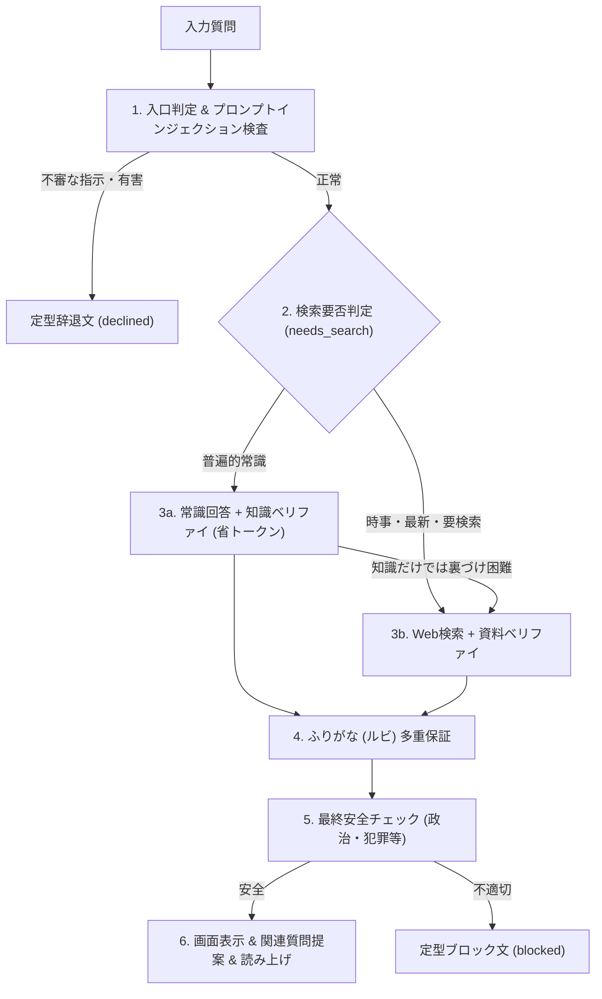

# 「しつもんしてね」仕様書

最終更新: 2026-11-15（第4版: スタンドアロン/GitHub Pages公開・デュアル実行対応）
対象:
- 方式A（完全クライアント動作）: `https://ym86.github.io/kids-ask-pad/` または `file://.../index.html`
- 方式B（ローカルサーバー動作）: `http://localhost:8787/` または `http://127.0.0.1:8787/`（`server.py`）
ソース: `index.html`、`server.py`

---

## 1. 目的と範囲

子ども（幼児〜小学生）と中学生が「なぜ？」を 1 問ずつ質問し、Web の公的資料や信頼できる知識で裏づけを取った答えを読むための Web ツール。

### 1.1 実行形態（デュアル構成）

1. **方式A：完全クライアント動作（GitHub Pages / `file://` 直接起動）**
   - サーバー不要。HTML ファイルをブラウザーで開くだけで全機能が動作する。
   - API キー（Google AI Studio または OpenRouter）はブラウザーの `localStorage`（キー: `kids_ask_pad_config_v1`）にのみ安全に保存。
   - ブラウザーから各 AI サービス公式エンドポイントへ直接 HTTPS 通信を行う（中間サーバーなし）。
   - 質問履歴や当日のトークン使用量もブラウザーの `localStorage`（キー: `kids_ask_pad_logs_v1`, `kids_ask_pad_usage_v1`）にのみ保存され、外部送信されない。
2. **方式B：ローカルサーバー動作（`server.py`）**
   - Python 3 標準ライブラリのみで起動（追加ライブラリ不要）。
   - API キーや設定はサーバー側ローカルファイル `data/config.json`（パーミッション 600、`.gitignore` 対象）に保存。
   - 質問ログは `data/qa/qa-YYYY-MM-DD.jsonl` に保存され、ブラウザー側にはキーやログを残さない。

### 1.2 画面と機能方針

- **1 問 1 答**: 画面は常に 1 問 1 答。新しい質問をすると直前の答えは消え、文脈を引きずらない。
- **音声機能**:
  - **読み上げ（`speechSynthesis`）**: ブラウザー標準の Web Speech API で全環境（HTTPS / HTTP / `file://`）において動作。
  - **音声入力（`SpeechRecognition`）**: Web Speech API の音声認識により、文字入力が苦手な幼児でもマイクから質問可能。**セキュアコンテキスト（HTTPS または localhost）必須**。GitHub Pages（HTTPS）やローカルサーバー（`localhost` / `127.0.0.1`）では利用可能。平文 LAN HTTP（例: `http://192.168.x.x`）ではブラウザーのセキュリティ仕様によりマイクが使えず、ボタンが自動非表示となる。
- **範囲外**:
  - 複数ターンの会話（チャット化による話題逸脱や誤認を防ぐため意図的に 1 問 1 答に限定）。
  - クラウド上の中央アカウント管理・ログイン（各家庭・各ブラウザーまたは各ローカル環境で完結）。

---

## 2. 画面仕様

### 2.1 構成（上から順）

| 要素 | id / selector | 内容 |
| --- | --- | --- |
| 使用量バー | `usage` | `きょうの トークン` / `きょうの 費用` / `のこり N 回` / `この しつもん` / `⚙️ 設定` ボタン |
| 見出し | — | `？ しつもんしてね`、`しりたいことを、おしえてね`、リード文 |
| 質問カード | `ask-form` | モード切替、きょうの なぜ？（`daily`）、質問入力欄（`textarea`）、`おしえて！`（`send`）、`こえで きく`（`mic-btn`）、文字数カウンター |
| 分野タブ | `cats` | モード別の分野切り替えタブ（`すべて`＋5〜6分野） |
| 質問例 | `chips` | 選択中の分野から 5 問のチップ＋`ほかの しつもんを みる` |
| 進行表示 | `thinking` | `しらべているよ…`（`aria-live="polite"`） |
| 答え | `answer` | 本文（`answer-text`、ふりがな付き）、注意書き（`notice`）、出典リンク / 基本知識ラベル（`sources`）、`よみあげ`、`もういちど`、関連質問ブロック（`related-block`） |
| エラー | `error` | `role="alert"`。通信失敗・上限・混雑をやわらかく表示 |
| 管理者画面ボタン | `admin-toggle` | ページ最下部の `おうちの ひとへ（管理・ログ）` |
| 管理者パネル | `admin-panel` | プロバイダー選択（Google AI Studio / OpenRouter）、API キー入力、モデル選択、文数・文字数制限、検索ログ一覧、パスワード設定 |

### 2.2 モード

| | こども向け（`kid`） | 中学生向け（`teen`） |
| --- | --- | --- |
| 対象 | 幼児〜小学生 | 中学生 |
| 文数・字数 | 4 文 / 420 字以内（既定） | 6 文 / 600 字以内（既定） |
| 文体 | ひらがな多め、やさしい話し言葉（`〜だよ`） | 順序立てた説明文（`〜です・ます`） |
| ふりがな | すべての漢字に必須（`<ruby>`） | 熟語・専門用語・時事用語等に付与 |
| 生成トークン上限 | 800 | 1,100 |
| 読み上げ | rate 0.88 / pitch 1.15 / 文間 220ms | rate 1.00 / pitch 1.00 / 文間 150ms |

切り替えは `mode-kid` / `mode-teen` の 2 ボタン。`aria-pressed` と `body.teen` が連動し、質問例・文体・読み上げパラメータが同時に入れ替わる。

### 2.3 「きょうの なぜ？」と分野別質問例チップ

- **きょうの なぜ？（`daily`）**:
  - その日の季節（春 3〜5月 / 夏 6〜8月 / 秋 9〜11月 / 冬 12〜2月）に合った質問を日付シード（`YYYYMMDD`）で 1 問ピックアップ（`renderDaily`）。
  - こども向けは `きょうの なぜ？`、中学生向けは `M月D日の なぜ？` のバッジを付け、タップすると質問欄に入力して即時送信。
- **分野タブ（`cats`）**:
  - こども向け: `すべて`（400） / `しぜん・うちゅう`（76） / `いきもの`（51） / `からだ・たべもの`（47） / `くらし・のりもの`（126） / `がっこうの まなび`（100）。
  - 中学生向け: `すべて`（400） / `物理・化学`（74） / `生物・人体`（50） / `地学・宇宙・環境`（74） / `数学・情報`（47） / `歴史・社会・経済`（125） / `ことば・芸術`（30）。
  - タブを押すと選択中の分野プールから 5 問を即座に選び直す。
- **質問例チップ（`chips`）**:
  - 選択中の分野プールから **重複なしで 5 問** をランダムに選ぶ（`renderChips`）。
  - チップを押すと入力欄へ転記し、そのまま送信する。
  - プール・分野定義・日替わり選出はすべてブラウザー内の静的処理のみ。サーバー呼び出しも費用も発生しない。

### 2.4 使用量表示

- **方式A（クライアント直）**:
  - ブラウザーの `localStorage`（`kids_ask_pad_usage_v1`）に記録された当日のトークン数・概算費用・残回数を表示。
- **方式B（ローカルサーバー）**:
  - 起動時に `GET /ask/api/usage` を呼び出し、回答ごとにレスポンスの `estimate` で更新。
- 項目: `きょうの トークン` / `きょうの 費用`（USD 小数 2 桁、無料枠利用時は `$0.00`） / `のこり N 回` / `この しつもん`（直前 1 問のトークン数）。

### 2.5 読み上げ・音声入力（Web Speech API）

外部有料サービスを使わず、ブラウザー標準の Web Speech API のみで動作。

- **読み上げ（`speechSynthesis`）**:
  - 話者: `lang` が `ja` の音声から優先順（`kyoko` → `o-ren` → `nanami` → `haruka` → `ayumi` → `sayaka` → `mizuki` → `google 日本語`）で選定。
  - 文分割: `SENTENCE_RE` で文ごとに `<span class="sent">` に分割。
  - 1 文ずつ `SpeechSynthesisUtterance` を再生し、読み上げ中の文には `class="sent spoken"`（薄い緑の帯）を付与。
  - `speakingGen`（世代番号）により、新しい質問・「けす」・モード切替時に古い発話を確実に破棄。
- **音声入力（`SpeechRecognition` / `webkitSpeechRecognition`）**:
  - 文字入力が不慣れな幼児向けに「こえで きく」マイクボタンを設置。
  - `interimResults: true` で話している途中経過をテキストエリアにリアルタイム反映。
  - 発話終了（`onend`）で自動確定し、フォーカスをセット。
  - **セキュアコンテキスト要件**: ブラウザーの仕様上、HTTPS（GitHub Pages など）または `http://localhost` / `http://127.0.0.1` でのみマイク API が有効化される。平文 LAN（`http://192.168.x.x`）や非対応ブラウザーではボタンが自動的に非表示となる。

### 2.6 「つぎは これを きいてみる？」（関連質問・深掘りチップ）

- 回答受信時、その内容を踏まえて子どもが次に興味を持ちそうな関連疑問（2〜3 問、ルビ付き）を自動生成して表示。
- チップをタップすると質問欄にセットされ、自動で次の回答を調べる。子どもの知的好奇心を自然に広げる設計。

### 2.7 状態と操作

| 操作 | 挙動 |
| --- | --- |
| 送信（`おしえて！`） | 入力 2 文字以上で送信処理開始。二重送信は無効化。 |
| 音声入力（`こえで きく`） | ボタンを押して話すとリアルタイムに入力。終了時に自動確定。 |
| 関連質問チップ | タップすると質問欄に入力され、自動で次の回答を調べる。 |
| 成功 | 答えを差し替え、ふりがなを付け、関連質問と出典を表示し、自動で読み上げる。 |
| 失敗 | `error` にメッセージ。答えは消さない（直前の答えを保持）。 |
| `けす` | 入力・答え・出典・関連質問・読み上げを消し、チップを選び直す。 |
| `もういちど` | 同じ質問を Web 検索優先（強制再調査）で再送する。 |
| 文字数 | 120 文字まで（JS 側で 120 字に制限し、`n / 120` を表示）。 |

### 2.8 状態の保存とプライバシー方針

- **方式A（完全クライアント動作 / GitHub Pages / `file://`）**:
  - サーバーレスで運用するため、保護者設定（API キー、選択モデル、文数上限、パスワードハッシュ）と直近の質問ログ（最大50件）をブラウザーの `localStorage` にのみ保存。
  - データは一切第三者や外部サーバーへ送信されない。
- **方式B（ローカルサーバー動作 / `server.py`）**:
  - ブラウザー側には API キーや質問ログを残さず、サーバー側の `data/config.json`（600）および `data/qa/` に保存。

---

## 3. 質問プール

| プール | 定数 | 件数 | 記法 |
| --- | --- | --- | --- |
| こども | `QUESTIONS` | 400 | ひらがな中心。ふりがな前提。 |
| 中学生 | `TEEN_QUESTIONS` | 400 | 漢字かな交じり。 |

### 3.1 内訳

こども（400 問）:
- しぜん・てんき 14 / きせつ 8 / しょくぶつ 8 / どうぶつ 19 / からだ 15 / たべもの 8
- うちゅう 8 / しくみ・のりもの 12 / ことば・くらし 8 / ちがく・しぜん 32
- くらし・るーる 18 / おかね・くらし 25 / むかしの はなし 25
- 小学校の学習内容 100（こくご・さんすう・りか・しゃかい・せいかつ）
- 身近な疑問・追加分 100（けんこう・いきもの・うちゅう・くらし・あそび等）

中学生（400 問）:
- 物理 22 / 化学 21 / 生物 22 / 地学・宇宙 23 / 数学 8 / 情報・技術 4 / 政治・公民 18 / 地質・地球科学 22 / 発展 10 / 金融・経済 25 / 歴史 25
- 小学校高学年・中学校の学習内容 100
- 応用・現代社会の疑問 100（数学情報・物理化学・生体医学・地球環境・地理歴史・政治経済・文化芸術）

### 3.2 構成とファイル分離

- 同一プール内・プール間とも重複させない。
- 質問プールは `questions.js`（静的 JS ファイル、約 53 KB）として分離されており、`index.html` から `<script src="questions.js"></script>` で読み込まれる。
- **`file://` 互換性**: ブラウザーで `index.html` を直接開く場合（方式A）でも、`fetch` の CORS 制約を受けずにマウント可能。`window.QUESTIONS` / `window.TEEN_QUESTIONS` に展開される。

---

## 4. API & 通信仕様

### 4.1 方式A：ブラウザー直接通信（GitHub Pages / `file://`）

ブラウザーから各公式 API エンドポイントへ直接 HTTPS リクエストを送信する。

1. **Google AI Studio（Gemini 無料枠）**:
   - `POST https://generativelanguage.googleapis.com/v1beta/models/{model}:generateContent?key={apiKey}`
   - Google Search Grounding (`tools: [{"googleSearch": {}}]`) による公的サイト引用。
2. **OpenRouter**:
   - `POST https://openrouter.ai/api/v1/chat/completions`
   - `plugins: [{"id": "web"}]` による Web 検索引用。
3. **Wikipedia API**:
   - `GET https://ja.wikipedia.org/w/api.php?...`（検索結果補完）

※ Content-Security-Policy（CSP）により、上記および `'self'` 以外の外部ホストへの通信はブラウザーが強制遮断する。

### 4.2 方式B：ローカルサーバー API（`server.py`）

ローカルで `server.py` を動かす場合の HTTP エンドポイント（待ち受け既定: `127.0.0.1:8787`）。

- `GET /` / `/index.html` / `/ask` / `/ask/index.html`: Web 画面配信
- `GET /questions.js` / `/ask/questions.js`: 質問プールスクリプト配信
- `GET /tests` / `/tests/index.html`: 検証テスト画面配信
- `GET /ask/api/health`: 稼働確認 `{"ok": true, "spend": ...}`
- `GET /ask/api/usage`: 当日の累計使用量・概算費用
- `POST /ask/api/ask`: 質問受付（本文最大 4KB、JSON `{ "question": "...", "mode": "kid"|"teen", "force_search": false }`）
- `GET /ask/api/admin/state`: 保護者画面の状態・設定・使用量・直近ログ（パスワード設定時はロック）
- `POST /ask/api/admin/auth`: 管理者パスワード照合
- `POST /ask/api/admin/config`: プロバイダー・API キー・モデル・文数制限設定の更新
- `POST /ask/api/admin/password`: 管理者パスワードの登録・変更

#### 制限値（サーバーモード）

| 項目 | 値 | 実装 |
| --- | --- | --- |
| レート制限 | 6 問 / 60 秒 / IP | `server.py` `rate_ok` |
| 同時実行 | 2 | `_sem`（待ち 8 秒で 503） |
| 1 日の費用上限 | `ASK_DAILY_USD_MAX`（既定 1.00 USD） | 超過で 503 `budget` |
| 本文サイズ | 4,096 バイト | `BODY_MAX` |

---

## 5. 回答パイプライン

サーバー側（`server.py`）およびクライアント直接実行側（`index.html`）の双方が、同一の多段防御パイプラインを備えている。



1. **分類＋Web 検索要否判定＋検索語生成**:
   - `category`、`needs_search`（時事・統計等の検索要否）、`query` を判定。
   - 性的・自傷・犯罪手順・政治意見はここで遮断し、外部呼び出しを行わず定型文を返す。
2. **常識回答＋知識ベリファイ（`needs_search == false`）**:
   - 自然科学の基本や普遍的事実は Web 検索プラグインを使わず回答・検証（トークン消費を約 1/3〜1/5 に削減）。
   - 知識だけでは十分な裏づけが得られない場合、自動的に Web 検索経路へフォールバック。
3. **検索付き回答＋資料ベリファイ（`needs_search == true` またはフォールバック時）**:
   - Google Search Grounding または OpenRouter Web プラグイン＋公的機関バイアス（`site:go.jp`、大学、研究機関）で検索。
   - 資料スニペットと回答を照合し、事実関係とふりがなを厳格に検査。
4. **ふりがな（ルビ）多重保証**:
   - ① 生成プロンプトでの漢字単独使用禁止の強制。
   - ② ベリファイモデルによるふりがな漏れ検査（`missing_readings`）。
   - ③ 未注記漢字の自動検出と文章を変えないルビ自動補完（`fill_missing_ruby`）。
5. **最終安全チェック**:
   - 回答本文が子どもの閲覧に適しているかを最終確認。
6. **記録**:
   - 質問・回答・消費トークン・判定（`verdict`）・出典を記録（方式Aは `localStorage`、方式Bは `data/qa/`）。

---

## 6. 安全方針

| 種類 | 入口の判定 | 応答 |
| --- | --- | --- |
| プロンプトインジェクション | `LOCAL_INJECTION_RE`、システム指示変更要求 | 辞退（指示の変更には対応できない旨の定型文） |
| 性的な内容 | `SEXUAL_RE` と分類 | 辞退（定型文） |
| 自傷・死にたい | `SELFHARM_RE` と分類 | 辞退。大人・公的相談窓口の案内 |
| 犯罪の手順 | `CRIME_HOWTO_RE` と分類 | 辞退。手順や回避のこつは書かない |
| 犯罪の理由・仕組み | `crime_fact` | 事実として回答（手順は書かない） |
| 政治の意見・評価 | `POLITICS_RE` と分類 | 辞退。制度・事実は中立に回答 |
| 政治の制度・事実 | `politics_fact` | 中立に回答 |

- **タグ隔離**: ユーザー入力に含まれる `<` `>` は `＜` `＞` に全角置換し、プロンプト内の `<question>` タグから脱出できないよう隔離。
- **検索演算子サニタイズ**: `site:`, `filetype:` などの意図しない演算子を無効化。
- **出典の公的機関優先**: 文部科学省、国立天文台、JAXA、大学、研究機関などの公的ドメインを優先して引用。

---

## 7. プロバイダー・モデル・設定

### 7.1 対応プロバイダー

1. **Google AI Studio（Gemini 無料枠あり）**:
   - エンドポイント: `https://generativelanguage.googleapis.com/v1beta/models/{model}:generateContent`
   - 回答モデル候補: `gemini-2.5-flash`（標準・推奨）、`gemini-2.5-flash-lite`（高速・軽量）、`gemini-2.0-flash`
   - 検証モデル候補: `gemini-2.5-flash-lite`（高速検証）、`gemini-2.5-flash`
   - 費用: **無料枠（1日 1,500 回まで費用 $0.00）**
   - Web 検索: Google Search Grounding による公式引用
2. **OpenRouter（多様なオープンモデル・従量課金）**:
   - エンドポイント: `https://openrouter.ai/api/v1/chat/completions`
   - モデル候補: `z-ai/glm-5.3-flash`, `google/gemini-2.5-flash`, `openai/gpt-6-luna`, `qwen/qwen3.5-flash-02-23`, `mistralai/ministral-8b-2512` 等
   - Web 検索: `plugins: [{"id": "web"}]`

### 7.2 設定の優先順位

- **方式A（クライアント直）**: 画面下部の「おうちの ひとへ（管理・ログ）」から設定（`localStorage` に保存）。
- **方式B（ローカルサーバー）**: `data/config.json` > 環境変数 / `.env`。

---

## 8. 記録とログ管理

### 8.1 方式A（完全クライアント動作）

- ブラウザーの `localStorage`（`kids_ask_pad_logs_v1`）に直近最大 50 件のログを JSON 形式で保存。
- 保存項目: 日時（`ts`）、モード（`mode`）、回答種別（`answer_type`）、質問（`q`）、回答（`a`）、判定（`verdict`）、トークン数（`tokens`）。
- 管理者画面で閲覧可能。外部送信は一切行わない。

### 8.2 方式B（ローカルサーバー動作）

- 保存先: `./data/` 配下
  - `data/qa/qa-YYYY-MM-DD.jsonl`: 1 リクエスト 1 行。180 日経過で自動削除。パーミッション 600。
  - `data/spend.json`: 日付ごとの累計費用（USD）。
  - `data/tokens.json`: 当日のトークン集計。
  - `data/config.json`: 管理者設定・ハッシュ化パスワード。

---

## 9. セキュリティ仕様

### 9.1 Web / ブラウザー側のセキュリティ（GitHub Pages & 共通）

- **Content-Security-Policy (CSP)**:
  `<meta http-equiv="Content-Security-Policy">` により、接続先を厳格にホワイトリスト化。
  ```text
  default-src 'none';
  script-src 'self' 'unsafe-inline';
  style-src 'self' 'unsafe-inline';
  connect-src 'self' https://generativelanguage.googleapis.com https://openrouter.ai https://ja.wikipedia.org;
  img-src 'self' data: https:;
  font-src 'self';
  base-uri 'none';
  form-action 'none';
  ```
- **X-Content-Type-Options**: `nosniff` を設定。
- **Referrer-Policy**: `strict-origin-when-cross-origin` を設定し、外部 API や外部リンクへの不要な URL 漏洩を防止。
- **クリックジャッキング防止（Frame-busting）**:
  悪意あるサイトが iframe で本ツールを埋め込み、API キーや入力を盗取するクリックジャッキング攻撃を防ぐため、フレーム内呼び出しを検知してリダイレクトまたは非表示化。
  ```javascript
  if (window.top !== window.self) {
    try { window.top.location = window.self.location; }
    catch (_) { document.documentElement.style.display = "none"; }
  }
  ```

### 9.2 Git / GitHub リポジトリセキュリティ

- **Secret Scanning & Push Protection**: API キーや秘密鍵の誤コミット・プッシュを GitHub 側でブロック。
- **Dependabot セキュリティ更新**: 依存脆弱性の自動検知・警告。
- **Private Vulnerability Reporting**: セキュリティ問題の非公開報告窓口を提供（`SECURITY.md` を配備）。
- **Branch Protection**: `main` ブランチへの強制プッシュ（Force push）および削除を禁止。
- **厳格な `.gitignore`**: `*.env*`, `ai.env`, `*.key`, `*.pem`, `credentials*.json`, `*.log`, `data/` を網羅的に除外。

### 9.3 サーバー側のセキュリティ（`server.py`）

- **バインド制限**: 既定では `127.0.0.1:8787` で待ち受け、外部からの直接アクセスを遮断。
- **管理者認証**: PBKDF2-HMAC-SHA256（120,000 回反復＋16 バイト乱数ソルト）によるパスワード保護。
- **セッショントークン**: 認証後はメモリ内トークン（有効 12 時間）を発行し、ファイル等には残さない。

---

## 10. 非機能要件

| 項目 | 目標・実測値 | 備考 |
| --- | --- | --- |
| 応答時間 | 5〜15 秒（検索・回答・検証の合計） | 常識回答時は 3〜6 秒で高速応答 |
| 1 問のトークン | 1,500〜5,000 トークン | 常識回答時は Web 検索時より大幅に削減 |
| 1 問の費用 | $0.00（Google AI Studio 無料枠）または約 $0.003〜0.008（OpenRouter） | 無料枠なら 1 日 1,500 問まで完全無料 |
| 動作環境（サーバー） | Python 3.8 以上（標準ライブラリのみ、OS 問わず動作） | メモリ数十 MB 程度で軽量動作 |
| 動作環境（ブラウザー） | Chrome, Edge, Safari, Firefox の各最新版 | PC, タブレット（iPad/Android）, スマホ対応 |

---

## 11. 開発・デプロイ手順

### 11.1 ローカル開発と検証

1. **ローカルサーバー起動**:
   ```powershell
   python server.py
   ```
   ブラウザーで `http://127.0.0.1:8787/` を開いて動作確認。
2. **静的検証・テスト**:
   - 総合検証スクリプト（Python 構文、質問プール整合性、HTML/CSP/DOM 検証）:
     ```powershell
     python tests/test_verify.py
     ```
   - ブラウザー内自動検証テスト:
     ブラウザーで `tests/index.html`（または `http://127.0.0.1:8787/tests/`）を開き、質問プール件数・重複・ルビ・管理パネルの存在などの自動テスト（全項目 PASS）を確認。
   - GitHub Actions CI:
     `main` ブランチへの push / PR 時に `.github/workflows/ci.yml` が自動実行され、リグレッションを防止。

### 11.2 リリース手順（GitHub Pages）

1. 変更ファイルをステージング・コミット:
   ```powershell
   git add index.html questions.js server.py docs/SPEC.md tests/
   git commit -m "feat/fix: ..."
   ```
2. `main` ブランチへプッシュ:
   ```powershell
   git push origin main
   ```
3. GitHub Actions の CI 検証および Pages デプロイ完了を確認:
   ```powershell
   gh run list --repo YM86/kids-ask-pad --limit 2
   ```
4. 公開環境（`https://ym86.github.io/kids-ask-pad/`）で表示と動作を確認。

---

## 12. 既知の制約と今後のロードマップ

1. **音声入力のセキュアコンテキスト制約**:
   - Web Speech API のマイク機能は、ブラウザーの仕様上セキュアコンテキスト（HTTPS または `localhost`）が必須。
   - GitHub Pages（`https://...`）やローカル起動（`http://localhost:8787/`）では問題なく動作する。
   - 家庭内 LAN の平文 HTTP（例: `http://192.168.x.x:8787/`）で iPad 等からアクセスした場合、ブラウザーがマイク API をブロックするためボタンが自動非表示となる。LAN 内で音声入力を使う場合は、リバースプロキシで HTTPS 化（オレオレ証明書またはローカル CA）するか、GitHub Pages 経由で利用する。
2. **質問プールの外部ファイル分離（完了）**:
   - 800 問の質問プール（約 53 KB）を `questions.js` として分離済み。
   - `file://` 起動でも CORS 制限を受けないよう、`<script src="questions.js"></script>` 形式の外部 JS ファイルとして読み込み。本体 HTML の大幅軽量化（177KB → 約90KB）と差分管理の容易化を達成。
3. **CI 自動テスト導入（完了）**:
   - `.github/workflows/ci.yml` および `tests/test_verify.py` を配備。push / PR 時に Python 構文チェック、質問プール整合性、セキュリティタグの自動回帰テストを実施。
4. **読み上げのプラットフォーム差**:
   - iOS Safari 等の一部モバイルブラウザーでは、ユーザー操作（タップ）を契機としない自動読み上げが制限される場合がある（その場合は「よみあげ」ボタンの手動タップで再生可能）。
   - iOS Safari 等の一部モバイルブラウザーでは、ユーザー操作（タップ）を契機としない自動読み上げが制限される場合がある（その場合は「よみあげ」ボタンの手動タップで再生可能）。
